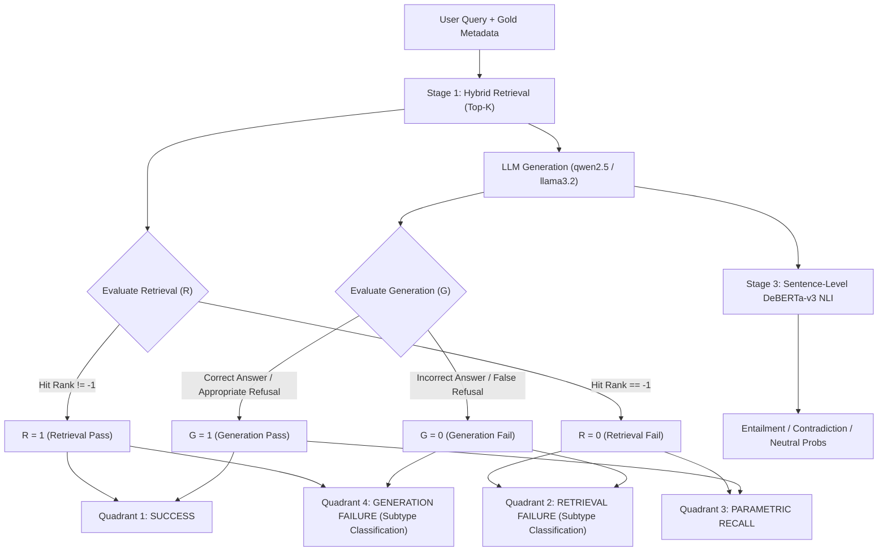

# 🔬 RAG Failure Modes & Detection Engine: Technical Guide

This document provides a comprehensive, rigorous technical breakdown of **every type of retrieval and generation failure** recognized by this project, explaining:
1. **Theoretical Definition**: What the failure actually represents.
2. **Root Cause**: The engineering or algorithmic breakdown that causes it.
3. **Detection Mechanics**: The exact mathematical formulas, algorithms, models, and thresholds used by the system to detect and classify it.
4. **Diagnostic Output**: How it is labeled in the dashboard, API, and benchmark logs.
5. **Mitigation Strategy**: The actionable engineering fix to eliminate or reduce the failure.

---

## 📑 1. Core Architecture: The $2 \times 2$ Decomposition Matrix

Every query processed through the evaluation engine is mapped onto a $2 \times 2$ Cartesian space defined by two binary outcomes:
* **Retrieval Outcome ($R \in \{0, 1\}$)**: Did the retriever return the requisite ground-truth evidence chunk in the top-$K$ slots?
* **Generation Outcome ($G \in \{0, 1\}$)**: Did the LLM synthesize an accurate, grounded answer matching the gold answer?

```
                                  RETRIEVAL STATUS
                       R = 0 (Retrieval Fail)      R = 1 (Retrieval Pass)
                  +-----------------------------+-----------------------------+
                  |                             |                             |
     G = 1        |        QUADRANT 3:          |        QUADRANT 1:          |
(Generation Pass) |    PARAMETRIC RECALL /      |          SUCCESS            |
                  |       SPURIOUS RECALL       |   (Evidence present and     |
                  |  (Answered from pre-trained |     answer is grounded)     |
                  |    weights without context) |                             |
                  +-----------------------------+-----------------------------+
                  |                             |                             |
     G = 0        |        QUADRANT 2:          |        QUADRANT 4:          |
(Generation Fail) |      RETRIEVAL FAILURE      |     GENERATION FAILURE      |
                  |   (Missing context, noise   |   (Hallucination, synthesis |
                  |   dilution, or boundary)    |   error, or contradiction)  |
                  |                             |                             |
                  +-----------------------------+-----------------------------+
```

### Component Attribution Equations
When system errors occur ($N_{\text{errors}} = N(Q_2) + N(Q_4)$), the framework calculates component fault attribution:

$$\alpha_R = \frac{N(Q_2)}{N_{\text{errors}}} \quad (\text{Retrieval Attribution Proportion})$$

$$\alpha_G = \frac{N(Q_4)}{N_{\text{errors}}} \quad (\text{Generation Attribution Proportion})$$

$$\text{Total Error Rate} = \frac{N(Q_2) + N(Q_4)}{N_{\text{total}}}$$

$$\text{Success Rate} = \frac{N(Q_1)}{N_{\text{total}}}$$

---

## 🛠️ 2. End-to-End Detection Pipeline

The detection pipeline executes in four sequential stages implemented across `src/evaluation/`:



---

## 🔍 3. Retrieval Failures ($R = 0$)

A retrieval failure occurs when the ground-truth evidence chunk $E^*$ is not captured within the top-$K$ ranking list returned by the retriever.

### How Retrieval is Evaluated ($R \in \{0, 1\}$)
Implemented in [`src/evaluation/metrics.py`](file:///c:/Users/thele/OneDrive/Desktop/NLP_Project/src/evaluation/metrics.py#L140-L187) via `evaluate_retrieval()`:
1. For each retrieved chunk $c_i \in \{c_1, \dots, c_K\}$, three matching criteria are tested against the gold evidence $E^*$:
   - **Exact Substring**: Normalized $E^* \subseteq c_i$ or $c_i \subseteq E^*$.
   - **Lexical Overlap**: Token Jaccard intersection $\frac{|T(E^*) \cap T(c_i)|}{|T(E^*)|} \ge 0.45$.
   - **Dense Semantic Similarity**: Cosine similarity $S_C(\mathbf{v}_{E^*}, \mathbf{v}_{c_i}) \ge \tau_{\text{ret}} = 0.60$.
2. If any retrieved chunk satisfies any of the three conditions, a **Hit** is registered at rank $i$, and $R = 1$.
3. If no chunk in the top-$K$ satisfies the criteria, $R = 0$ (**Retrieval Failure**).

Once $R = 0$ is established, the error decomposer determines the exact **retrieval subtype**:

---

### Failure 1: `MISSING_EVIDENCE` (Information Absent from Index)
* **Description**: The query asks for information that either does not exist in the indexed corpus or has zero semantic and lexical overlap with any indexed chunk.
* **Root Cause**: Incomplete knowledge ingestion, out-of-domain query, or unindexed documents.
* **How It Is Detected**:
  $$\max_{i \in [1, K]} S_C(\mathbf{v}_{E^*}, \mathbf{v}_{c_i}) < 0.35$$
  The maximum cosine similarity across all retrieved chunks is strictly below $0.35$.
* **Diagnostic Explanation**: *"Top-K chunks contained no semantic overlap with the required ground-truth evidence."*
* **Engineering Mitigation**: Ingest missing reference documents or expand knowledge base coverage.

---

### Failure 2: `NOISE_DILUTION` (Context Dilution by Distractors)
* **Description**: The corpus contains relevant evidence, but non-relevant distractor chunks dominated the top-$K$ slots, diluting the context density.
* **Root Cause**: Overly large $K$ ($K \ge 8$), high embedding collision between distractor topics, or inadequate keyword discrimination.
* **How It Is Detected**:
  $$\text{Precision@}K = \frac{|\{c_i : \text{is\_hit}(c_i) = \text{True}\}|}{K} < 0.30 \quad \text{with} \quad \max_{i} S_C \ge 0.35$$
  Relevant evidence had moderate similarity, but precision within top-$K$ was less than 30%, pushing the true evidence out of the top rank or burying it beneath noise.
* **Diagnostic Explanation**: *"Distractor chunks pushed evidence beyond ranking threshold or diluted retrieval fidelity."*
* **Engineering Mitigation**: Tune $K$ to the knee point ($K^* = 3$); introduce a Cross-Encoder Reranker (e.g. `ms-marco-MiniLM-L-6-v2`) to prune distractors before LLM context construction.

---

### Failure 3: `TRUNCATION_BOUNDARY` (Entity Split Across Chunks)
* **Description**: The factual premise or formula was split across a hard character boundary during chunking, so neither chunk contained sufficient complete evidence to pass the retrieval threshold.
* **Root Cause**: Arbitrary fixed-character chunking (e.g. naive 400-character slicing) without sentence boundary awareness.
* **How It Is Detected**:
  $$\text{Precision@}K \ge 0.30 \quad \text{and} \quad \max_{i} S_C \ge 0.35 \quad \text{but} \quad \text{HitRank} = -1$$
  High individual token overlap exists across adjacent chunks, but neither chunk independently satisfies the complete factual containment threshold.
* **Diagnostic Explanation**: *"Partial context retrieved, but key factual terms were cut off across chunk boundaries."*
* **Engineering Mitigation**: Employ **Parent-Document (Hierarchical) Retrieval**: embed granular child chunks (~250 characters) for high-precision retrieval, but inject the full parent chunk (~1,200 characters) into the LLM context prompt.

---

## 🤖 4. Generation Failures ($R = 1, G = 0$)

A generation failure occurs when the retriever successfully captured the ground-truth evidence in top-$K$ ($R = 1$), but the generator produced an incorrect, hallucinated, contradictory, or refusing output ($G = 0$).

### How Generation is Evaluated ($G \in \{0, 1\}$)
Implemented in [`src/evaluation/metrics.py`](file:///c:/Users/thele/OneDrive/Desktop/NLP_Project/src/evaluation/metrics.py#L189-L270) via `evaluate_generation()`:
1. **Refusal Check**: Checks for standard refusal signatures (*"does not contain sufficient evidence"*, *"insufficient evidence"*, *"unanswerable"*).
2. **Similarity & Overlap Metrics**:
   - **Token F1**: Harmonic mean of precision and recall between prediction and gold tokens.
   - **ROUGE-L**: Longest common subsequence ratio.
   - **Semantic Cosine Similarity**: $S_C(\mathbf{v}_{\text{pred}}, \mathbf{v}_{\text{gold}})$ via `all-MiniLM-L6-v2`.
   - **Token Recall**: Proportion of gold tokens present in the prediction.
   - **Substring Match**: Complete inclusion of the gold answer string within the prediction.
3. **Composite Scoring**:
   $$\text{Composite} = 0.4 \cdot S_C + 0.3 \cdot F_1 + 0.3 \cdot \text{ROUGE-L}$$
   Generation passes ($G = 1$) if:
   $$S_C \ge 0.65 \quad \lor \quad F_1 \ge 0.50 \quad \lor \quad \text{Composite} \ge 0.50 \quad \lor \quad \text{SubstringMatch} \quad \lor \quad (\text{Recall} \ge 0.80 \land S_C \ge 0.50)$$

If $G = 0$ while $R = 1$, the sample is routed to the **NLI Faithfulness Engine** to assign the generation failure subtype:

---

### Failure 4: `HALLUCINATION_UNSUPPORTED` (Fabricated Claims)
* **Description**: Evidence was retrieved, but the LLM introduced extraneous, ungrounded factual claims not supported by the context.
* **Root Cause**: High decoding temperature ($T > 0.3$), weak instruction adherence, or parametric memory bleeding into the output.
* **How It Is Detected**:
  Implemented in [`src/evaluation/nli_grounding.py`](file:///c:/Users/thele/OneDrive/Desktop/NLP_Project/src/evaluation/nli_grounding.py):
  1. The generated answer is decomposed into individual sentence claims: $A = \{s_1, s_2, \dots, s_m\}$.
  2. For each claim $s_j$, candidate premise sentences $P = \{p_1, \dots, p_n\}$ are extracted from the retrieved chunks.
  3. The Cross-Encoder model `cross-encoder/nli-deberta-v3-small` computes softmax probabilities:
     $$\mathbf{P}(s_j \mid p_k) = [P_{\text{contra}}, P_{\text{entail}}, P_{\text{neutral}}]$$
  4. Best entailment probability:
     $$E(s_j) = \max_k P_{\text{entail}}(s_j \mid p_k)$$
  5. Faithfulness score is the proportion of entailed claims:
     $$\text{Faithfulness} = \frac{1}{m} \sum_{j=1}^m \mathbb{I}(E(s_j) \ge 0.50)$$
  6. **Trigger**: If $\text{Faithfulness} < \tau_{\text{faithful}} = 0.70$ and no contradiction is detected, the failure is labeled `HALLUCINATION_UNSUPPORTED`.
* **Diagnostic Explanation**: *"Evidence was present, but the LLM hallucinated ungrounded claims not supported by the context."*
* **Engineering Mitigation**: Lower temperature to $0.0$; use strict prompt instructions: *"Answer strictly using only the provided context. If the answer cannot be directly derived, refuse to answer."*

---

### Failure 5: `CONTEXT_CONTRADICTION` (Logical Negation of Evidence)
* **Description**: The LLM asserted a statement that directly inverts, negates, or contradicts a fact explicitly stated in the retrieved context.
* **Root Cause**: Token-inversion in small language models (e.g. confusing "increases" with "decreases"), negation-blind attention heads, or flawed arithmetic deduction.
* **How It Is Detected**:
  $$\max_k P_{\text{contra}}(s_j \mid p_k) \ge 0.60 \quad \text{and} \quad \max_k P_{\text{entail}}(s_j \mid p_k) < 0.25$$
  The cross-encoder assigns high contradiction confidence ($\ge 60\%$) with very low entailment ($< 25\%$) between any generated claim and any retrieved premise sentence.
* **Diagnostic Explanation**: *"Evidence was present, but the LLM generated statements contradicting facts in the context."*
* **Engineering Mitigation**: Add explicit negative constraint prompts; run real-time post-generation NLI rejection filtering.

---

### Failure 6: `REASONING_SYNTHESIS_ERROR` (Multi-Hop Deductive Failure)
* **Description**: All necessary factual premises were retrieved across separate chunks (e.g. Chunk A contains Premise 1, Chunk B contains Premise 2), but the LLM failed to infer the logical connection between them.
* **Root Cause**: Limited reasoning capacity in smaller parameter models (e.g. 3B models) when processing multi-step causal or mathematical arguments.
* **How It Is Detected**:
  $$R = 1 \quad \land \quad G = 0 \quad \land \quad \text{question\_type} \in \{\text{"multi-hop"}, \text{"reasoning"}\} \quad \land \quad \text{is\_faithful} = \text{True}$$
  Retrieval succeeded, the statements made by the model were factually faithful to the individual chunks (no hallucination), but the final deduced conclusion did not match the gold answer.
* **Diagnostic Explanation**: *"Evidence chunks were present, but the model failed to synthesize multi-hop logic correctly."*
* **Engineering Mitigation**: Apply **Chain-of-Thought (CoT)** prompt scaffolding (*"Think step-by-step before answering"*); upgrade generator to a higher-capacity reasoning model.

---

### Failure 7: `CONSERVATIVE_REFUSAL` (False Refusal)
* **Description**: Ground-truth evidence was present in the retrieved context, but the LLM refused to answer (e.g. *"I am sorry, but the provided text does not contain this information"*).
* **Root Cause**: Overly strict prompt guardrails, excessive safety penalties, or tabular data formatted without Markdown headers.
* **How It Is Detected**:
  $$R = 1 \quad \land \quad \text{is\_refusal}(\text{prediction}) = \text{True} \quad \land \quad \text{gold\_is\_unanswerable} = \text{False}$$
* **Diagnostic Explanation**: *"Evidence was present in the retrieved context, but the LLM exhibited over-conservative refusal ('I don't know')."*
* **Engineering Mitigation**: Soften refusal instructions; provide table headers and row prefixes during ingestion so tabular data is legible to attention heads.

---

### Failure 8: `INCOMPLETE_ANSWER` (Partial Coverage of Multi-Part Query)
* **Description**: The query asked for multiple properties or entities, but the LLM only provided a subset (e.g. omitted the third metric in a comparative table).
* **Root Cause**: Output token limits, early stopping token generation, or shallow attention over long contexts.
* **How It Is Detected**:
  $$R = 1 \quad \land \quad G = 0 \quad \land \quad 0.20 \le \text{Token Recall} < 0.80 \quad \land \quad \text{is\_faithful} = \text{True}$$
  Claims were faithful to the context and some gold tokens were retrieved, but coverage fell short of the complete gold standard.
* **Diagnostic Explanation**: *"Evidence was present, but the answer was incomplete or low fidelity."*
* **Engineering Mitigation**: Request **Structured JSON Output** with explicit schema fields enforced via Pydantic or constrained grammars.

---

## 🌪️ 5. Cascading Failures ($R = 0 \to G = 0$)

A **Cascading Failure** occurs when a failure at the retrieval stage propagates down the pipeline, directly causing a failure at the generation stage.

```
Retriever Misses Evidence (R = 0)
              │
              ▼
Context Prompt Lacks Factual Grounding
              │
              ├─────────────────────────────────────────┐
              ▼                                         ▼
LLM Fabricates an Ungrounded Answer        LLM Produces an Inappropriate Refusal
     [CASCADING_HALLUCINATION]                    [CASCADING_REFUSAL]
```

### 1. `CASCADING_HALLUCINATION`
- **Occurrence**: $R = 0$, $G = 0$, `is_refusal = False`.
- **Mechanics**: The retriever returned irrelevant distractor chunks. Rather than refusing, the LLM attempted to answer using the distractor text or guessed using parametric memory, generating a completely ungrounded answer.
- **Attribution**: Primarily attributed to Retrieval ($\alpha_R = 1.0$), because providing the correct context would have grounded the generator.

### 2. `CASCADING_REFUSAL`
- **Occurrence**: $R = 0$, $G = 0$, `is_refusal = True` on an **answerable** question.
- **Mechanics**: The question had a known factual answer in the original document, but because the retriever failed to return the relevant chunk, the model responded with *"I don't know"*.
- **Attribution**: Classified as a Retrieval Failure ($Q_2$), because the LLM behaved strictly according to instructions (refusing when context is absent), and the failure originated solely from the retrieval gap.

---

## ⚡ 6. Spurious & Boundary Modes

### 1. `PARAMETRIC_RECALL` ($R = 0, G = 1$)
* **Description**: The retriever completely failed to find the evidence in the corpus, yet the LLM answered the question correctly.
* **Root Cause**: **Pre-trained Parametric Memory Leakage**. The model memorized the factual information during pre-training (e.g. world capitals, common scientific formulas, public historical dates).
* **Why It Is Dangerous**: In an enterprise RAG system, parametric recall creates a false sense of security. If the underlying policy, contract, or roll number changes in private documents, the model will continue outputting pre-trained memory rather than reflecting the indexed document.
* **How It Is Detected**:
  $$R = 0 \quad \land \quad G = 1 \quad \land \quad \text{gold\_is\_unanswerable} = \text{False}$$
* **Diagnostic Explanation**: *"Evidence was missing from retrieved context, but the LLM answered correctly using pre-trained parametric memory."*

---

### 2. `UNANSWERABLE_CORRECT_REFUSAL` ($R = 0, G = 1$ for Adversarial Queries)
* **Description**: An adversarial or out-of-domain query was submitted (e.g. asking for the battery capacity of Apollo 11's fictional warp drive). The retriever found no evidence, and the model correctly answered: *"The provided context does not contain sufficient evidence to answer this question."*
* **Evaluation Alignment**: Because the gold answer specifies unanswerability, a refusal is a **True Positive Success ($G = 1$)**, mapped into **Quadrant 1 (SUCCESS)** with subtype `UNANSWERABLE_CORRECT_REFUSAL`.
* **Diagnostic Explanation**: *"Adversarial/unanswerable query: evidence does not exist in knowledge base and LLM appropriately refused."*

---

## 📊 7. Complete Failure Taxonomy & Detection Parameters

| Failure Mode | Quadrant | Primary Fault | Detection Criteria / Threshold | Core Indicator |
| :--- | :---: | :---: | :--- | :--- |
| `SUCCESS` | Q1 | None | $R = 1 \land G = 1 \land \text{Faithfulness} \ge 0.70$ | Evidence grounded, answer correct |
| `UNANSWERABLE_CORRECT_REFUSAL` | Q1 | None | $\text{Gold} = \text{Unans} \land \text{Refusal} = \text{True}$ | Appropriate refusal of adversarial prompt |
| `MISSING_EVIDENCE` | Q2 | Retrieval | $R = 0 \land \max S_C < 0.35$ | Zero semantic overlap with index |
| `NOISE_DILUTION` | Q2 | Retrieval | $R = 0 \land \text{Precision@}K < 0.30 \land \max S_C \ge 0.35$ | Distractor chunks dilute ranking |
| `TRUNCATION_BOUNDARY` | Q2 | Ingestion | $R = 0 \land \text{Precision@}K \ge 0.30 \land \text{HitRank} = -1$ | Clause split across chunk boundary |
| `HALLUCINATION_UNSUPPORTED` | Q4 | Generation | $R = 1 \land G = 0 \land \text{Faithfulness} < 0.70 \land \text{Contra} = \text{False}$ | Extraneous ungrounded claims |
| `CONTEXT_CONTRADICTION` | Q4 | Generation | $R = 1 \land G = 0 \land P_{\text{contra}} \ge 0.60$ | Direct logical negation of context |
| `REASONING_SYNTHESIS_ERROR` | Q4 | Generation | $R = 1 \land G = 0 \land \text{Type} \in \{\text{multi-hop}\} \land \text{Faithful} = \text{True}$ | Deduction failed across multiple chunks |
| `CONSERVATIVE_REFUSAL` | Q4 | Generation | $R = 1 \land G = 0 \land \text{Refusal} = \text{True} \land \text{Gold} \neq \text{Unans}$ | Refused despite context being present |
| `INCOMPLETE_ANSWER` | Q4 | Generation | $R = 1 \land G = 0 \land 0.20 \le \text{Recall} < 0.80 \land \text{Faithful} = \text{True}$ | Missing aspects of multi-part question |
| `PARAMETRIC_RECALL` | Q3 | Parametric | $R = 0 \land G = 1 \land \text{Gold} \neq \text{Unans}$ | Answered from pre-trained memory |

---

## 🔗 8. Source Code References

| Functionality | Source File | Key Functions / Classes |
| :--- | :--- | :--- |
| Error Decomposition & Quadrant Routing | [`src/evaluation/error_decomposer.py`](file:///c:/Users/thele/OneDrive/Desktop/NLP_Project/src/evaluation/error_decomposer.py) | `ErrorDecomposer.evaluate_sample()`, `aggregate_results()` |
| Sentence-Level NLI Faithfulness | [`src/evaluation/nli_grounding.py`](file:///c:/Users/thele/OneDrive/Desktop/NLP_Project/src/evaluation/nli_grounding.py) | `GroundingEvaluator.evaluate_groundedness()` |
| Retrieval & Generation Metrics | [`src/evaluation/metrics.py`](file:///c:/Users/thele/OneDrive/Desktop/NLP_Project/src/evaluation/metrics.py) | `evaluate_retrieval()`, `evaluate_generation()`, `calculate_token_f1()` |
| Hybrid Retrieval Engine | [`src/retrieval/hybrid_retriever.py`](file:///c:/Users/thele/OneDrive/Desktop/NLP_Project/src/retrieval/hybrid_retriever.py) | `HybridRetriever.retrieve()`, `reciprocal_rank_fusion()` |
| Vector Embeddings | [`src/retrieval/embedder.py`](file:///c:/Users/thele/OneDrive/Desktop/NLP_Project/src/retrieval/embedder.py) | `DenseEmbedder.embed_texts()`, `embed_query()` |
| BM25 Keyword Search | [`src/retrieval/bm25_retriever.py`](file:///c:/Users/thele/OneDrive/Desktop/NLP_Project/src/retrieval/bm25_retriever.py) | `BM25Retriever.search()` |
| Configuration & Thresholds | [`src/config.py`](file:///c:/Users/thele/OneDrive/Desktop/NLP_Project/src/config.py) | `RETRIEVAL_SIMILARITY_THRESHOLD`, `FAITHFULNESS_THRESHOLD` |
